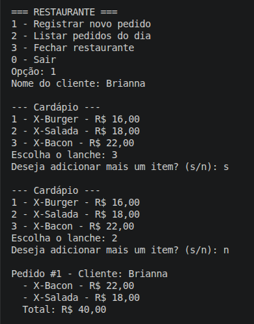
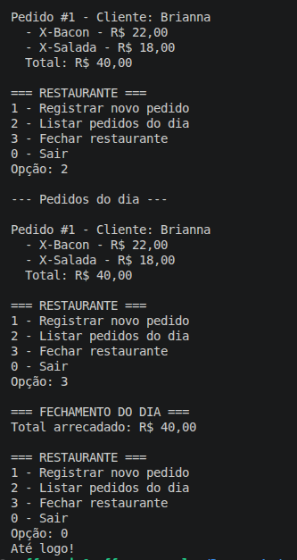
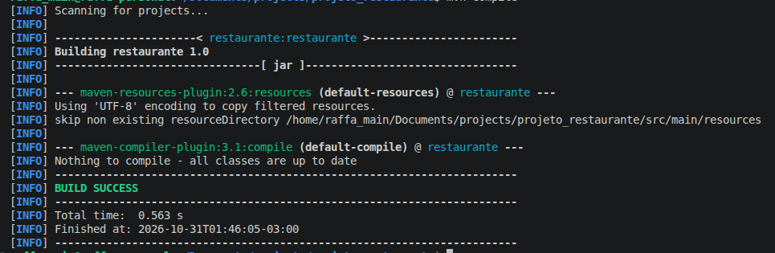

### Projeto 1: Sistema de Restaurante (Níveis 1, 2 e 3)

### Objetivo

Construir o sistema de um restaurante em Java, com cardápio, pedidos e fechamento do dia, organizado em pacotes e com cada classe cuidando de uma responsabilidade.

- **Nível 1:** cardápio, pedidos e fechamento do dia.
- **Nível 2:** interface `ItemCardapio`, `LancheFactory` e adicionais com Decorator.
- **Nível 3 (até aqui):** personalização do lanche (retirar ingredientes sem mudar o preço) e modificação de pedidos (acrescentar item, remover item e cancelar pedido).

---

### 1. Como organizei os pacotes e por quê

```
projeto_restaurante/
├── pom.xml
└── src/
    ├── main/java/
    │   ├── app/
    │   │   ├── Main.java
    │   │   ├── MenuConsole.java
    │   │   └── Restaurante.java
    │   ├── cardapio/
    │   │   ├── ItemCardapio.java
    │   │   ├── Lanche.java
    │   │   ├── LancheFactory.java
    │   │   ├── AdicionalDecorator.java
    │   │   ├── ComCheddar.java
    │   │   └── ComBaconExtra.java
    │   └── pedido/
    │       ├── Pedido.java
    │       └── GerenciadorPedidos.java
    └── test/java/
        ├── cardapio/
        │   ├── LancheTest.java
        │   ├── LancheFactoryTest.java
        │   └── AdicionaisTest.java
        └── pedido/
            ├── PedidoTest.java
            └── GerenciadorPedidosTest.java
```

| Pacote | O que guarda | Por que ali |
|---|---|---|
| `app` | `Main`, `MenuConsole`, `Restaurante` | É a camada que conversa com a pessoa e coordena as operações. Tudo que mexe com tela e fluxo fica junto. |
| `cardapio` | `ItemCardapio`, `Lanche`, `LancheFactory`, adicionais | É o "produto" do restaurante: o que se vende, como é criado e o que pode ser acrescentado. Não depende de nenhum outro pacote. |
| `pedido` | `Pedido`, `GerenciadorPedidos` | Tudo que trata de comandas: uma comanda (`Pedido`) e o conjunto delas (`GerenciadorPedidos`). |
| `financeiro` e `util` | (ainda vazios) | Só serão criados quando houver classe para colocar neles. O Git não versiona pasta vazia. |

**A regra que guiou a divisão:** cada parte tem uma responsabilidade, e as dependências vão sempre em uma direção só.

```
app  ──►  pedido  ──►  cardapio
```

- `cardapio` não conhece ninguém.
- `pedido` conhece `cardapio` (um pedido tem itens do cardápio), mas não conhece `app`.
- `app` conhece os dois e é a única camada que imprime e lê dados.

Com isso, dá para trocar o console por outra interface (por exemplo, uma tela gráfica) mexendo só em `app`, sem tocar em `pedido` nem `cardapio`. Os testes ficam em `src/test/java` com os mesmos nomes de pacote das classes que testam.

### Responsabilidade de cada classe

| Classe | Responsabilidade |
|---|---|
| `ItemCardapio` | Contrato do que pode entrar em um pedido: tem descrição e preço |
| `Lanche` | Guarda nome, preço, ingredientes e quais ingredientes foram retirados, com validação nos setters. Implementa `ItemCardapio` |
| `LancheFactory` | Cria os lanches padrão do cardápio (X-Burger, X-Salada, X-Bacon) |
| `AdicionalDecorator` | Base dos adicionais: é um `ItemCardapio` e guarda outro `ItemCardapio` dentro de si |
| `ComCheddar` | Acrescenta `+ cheddar` à descrição e R$ 4,00 ao preço |
| `ComBaconExtra` | Acrescenta `+ bacon extra` à descrição e R$ 6,00 ao preço |
| `Pedido` | Cuida de **uma** comanda: número, cliente e lista de `ItemCardapio`. Também remove um item pela posição |
| `GerenciadorPedidos` | Guarda **todos** os pedidos (`HashMap`), gera o número, soma o total do dia e cancela pedidos |
| `Restaurante` | Coordena as operações, pede os lanches à factory, aplica a personalização escolhida e as alterações no pedido |
| `MenuConsole` | Toda a leitura (`Scanner`) e exibição (`System.out`), incluindo a pergunta de quais ingredientes retirar e o menu de modificação do pedido |
| `Main` | Controla o fluxo principal (loop e `switch`), sem cálculo nem impressão |

`Pedido` e `GerenciadorPedidos` são classes separadas de propósito (o S do SOLID): o pedido não sabe quantos pedidos existem, e o gerenciador não sabe calcular o total de uma comanda.

---

### 2. Regras implementadas

- **Lanche:** o nome não pode ser nulo nem vazio, e o preço não pode ser negativo. O construtor reutiliza os setters, então a validação fica em um lugar só. Valor inválido lança `IllegalArgumentException`. A lista de ingredientes é copiada na criação, então dois lanches nunca compartilham a mesma lista.
- **Pedido:** o nome do cliente não pode ser nulo nem vazio. O número chega pronto pelo construtor. `adicionarItem` recebe um `ItemCardapio` (não só `Lanche`). `calcularTotal()` percorre a lista com `for`.
- **Personalização:** o cliente pode retirar queijo, alface, tomate ou cebola. Retirar ingrediente muda só a descrição (`X-Bacon sem cebola`), nunca o preço. Os quatro campos nascem com `= true` na declaração, senão o `boolean` começaria `false` e o lanche viria sem nada. Cada item do pedido é um objeto novo, então a personalização de um pedido não afeta outro.
- **Modificar pedido:** o pedido é buscado pelo número e pode receber um item novo, perder um item (escolhido pelo número na lista) ou ser cancelado inteiro. Um lanche já criado nunca é editado: para trocar um X-Bacon por um X-Bacon sem cebola, remove-se o item anterior e acrescenta-se o novo. O total sempre reflete a lista atualizada, e um pedido cancelado sai do total do dia.
- **Adicionais:** cada adicional embrulha um `ItemCardapio`, soma o seu preço ao do item embrulhado e acrescenta a sua descrição no formato exato `+ cheddar` ou `+ bacon extra` (espaço, sinal de mais, espaço, minúsculas). Embrulhar um item nulo lança `IllegalArgumentException`. O lanche original nunca é alterado.
- **GerenciadorPedidos:** `criarPedido` gera o número com `contadorPedidos++`. O usuário nunca digita o número de um pedido novo, então a numeração não se repete (o `HashMap` não recusa chave repetida, ele **substitui**).
- **Lanche novo a cada escolha:** cada método da `LancheFactory` faz `new Lanche(...)` a cada chamada. Dois clientes que pedem X-Bacon recebem objetos diferentes, e alterar um não muda o outro.

### Cardápio

| Opção | Lanche | Preço | Ingredientes |
|---|---|---|---|
| 1 | X-Burger | R$ 16,00 | pão, hambúrguer, queijo, alface, tomate |
| 2 | X-Salada | R$ 18,00 | pão, hambúrguer, queijo, alface, tomate, cebola |
| 3 | X-Bacon | R$ 22,00 | pão, hambúrguer, queijo, bacon, alface, tomate, cebola |

---

### 3. Um pedido do começo ao fim

Execução real do sistema (Nível 1), com a classe responsável por cada passo:

```
=== RESTAURANTE ===
1 - Registrar novo pedido
2 - Listar pedidos do dia
3 - Fechar restaurante
0 - Sair
Opção: 1
Nome do cliente: Brianna

--- Cardápio ---
1 - X-Burger - R$ 16,00
2 - X-Salada - R$ 18,00
3 - X-Bacon - R$ 22,00
Escolha o lanche: 3
Deseja adicionar mais um item? (s/n): s

--- Cardápio ---
1 - X-Burger - R$ 16,00
2 - X-Salada - R$ 18,00
3 - X-Bacon - R$ 22,00
Escolha o lanche: 2
Deseja adicionar mais um item? (s/n): n

Pedido #1 - Cliente: Brianna
  - X-Bacon - R$ 22,00
  - X-Salada - R$ 18,00
  Total: R$ 40,00
```

Depois, listar e fechar o dia:

```
Opção: 2

--- Pedidos do dia ---

Pedido #1 - Cliente: Brianna
  - X-Bacon - R$ 22,00
  - X-Salada - R$ 18,00
  Total: R$ 40,00

Opção: 3

=== FECHAMENTO DO DIA ===
Total arrecadado: R$ 40,00

Opção: 0
Até logo!
```




**A partir do Nível 2**, o cardápio também mostra os ingredientes de cada lanche:

```
--- Cardápio ---
1 - X-Burger - R$ 16,00
      pão, hambúrguer, queijo, alface, tomate
2 - X-Salada - R$ 18,00
      pão, hambúrguer, queijo, alface, tomate, cebola
3 - X-Bacon - R$ 22,00
      pão, hambúrguer, queijo, bacon, alface, tomate, cebola
```

**A partir do Nível 3**, ao escolher o lanche o sistema pergunta quais ingredientes retirar (formato produzido pelo código):

```
Escolha o lanche: 3
Quer retirar algum ingrediente? (o preço não muda)
  Retirar queijo? (s/n): n
  Retirar alface? (s/n): n
  Retirar tomate? (s/n): n
  Retirar cebola? (s/n): s
Deseja adicionar mais um item? (s/n): n

Pedido #1 - Cliente: Brianna
  - X-Bacon sem cebola - R$ 22,00
  Total: R$ 22,00
```

**A partir do Nível 3**, a opção 4 do menu modifica um pedido (formato produzido pelo código; aqui o pedido #1 tem X-Bacon e X-Salada):

```
Opção: 4
Número do pedido: 1

Pedido #1 - Cliente: Brianna
  - X-Bacon - R$ 22,00
  - X-Salada - R$ 18,00
  Total: R$ 40,00

--- Modificar pedido ---
1 - Acrescentar item
2 - Remover item
3 - Cancelar pedido inteiro
0 - Voltar
Opção: 2

Itens do pedido #1:
  1 - X-Bacon - R$ 22,00
  2 - X-Salada - R$ 18,00
Número do item a remover: 2
Item removido.

Pedido #1 - Cliente: Brianna
  - X-Bacon - R$ 22,00
  Total: R$ 22,00
```

**O que cada classe fez nesse caminho:**

| Passo | Quem executa |
|---|---|
| Mostrar o menu e ler a opção `1` | `MenuConsole` (`exibirMenu`, `lerOpcao`) |
| Ler o nome "Brianna" | `MenuConsole` (`lerNomeCliente`) |
| Criar o pedido e dar o número `#1` | `Restaurante` → `GerenciadorPedidos.criarPedido` → `new Pedido(1, "Brianna")` |
| Mostrar o cardápio e ler a escolha `3` | `MenuConsole` (`exibirCardapio`, `lerOpcaoLanche`) |
| Perguntar quais ingredientes retirar (Nível 3) | `MenuConsole` (`lerIngredientesParaRetirar`) |
| Criar o X-Bacon, retirar ingredientes e colocar no pedido | `Restaurante.adicionarItem` → `criarLanche(3)` → `LancheFactory.xBacon()` → setters dos ingredientes retirados → `Pedido.adicionarItem` |
| Perguntar "mais um item?" | `MenuConsole` (`perguntarMaisItem`) |
| Repetir com a escolha `2` (X-Salada) | Mesmo caminho, com um `Lanche` novo vindo da factory |
| Calcular R$ 40,00 | `Pedido.calcularTotal` (22 + 18) |
| Mostrar o pedido | `MenuConsole.exibirPedido` |
| Fechamento do dia | `GerenciadorPedidos.calcularTotalDoDia` → `MenuConsole.exibirFechamentoDoDia` |

Repare que o `Main` só repassa o que o `MenuConsole` leu para a `Restaurante`, e o que ela devolve para o `MenuConsole` exibir.

---

### 4. Padrão de projeto: Facade

**Onde está:** `Restaurante`, no pacote `app`.

**O problema que resolveu:** para registrar um item em um pedido, é preciso fazer várias coisas em ordem: achar o pedido no `GerenciadorPedidos`, pedir o `Lanche` certo e colocá-lo no `Pedido`. Sem a fachada, o `Main` teria que conhecer todas essas classes e coordenar esse passo a passo:

```java
// Sem a fachada: o Main precisa conhecer tudo
GerenciadorPedidos gerenciador = new GerenciadorPedidos();
Pedido pedido = gerenciador.buscarPedido(numero);
Lanche lanche;
switch (escolha) {
    case 1: lanche = LancheFactory.xBurger(); break;
    case 2: lanche = LancheFactory.xSalada(); break;
    case 3: lanche = LancheFactory.xBacon(); break;
    default: lanche = null;
}
pedido.adicionarItem(lanche);
```

Isso mistura fluxo do programa com regras de negócio, e qualquer mudança (um lanche novo, outra forma de guardar os pedidos) obrigaria a mexer no `Main`.

**Com a fachada**, o `Main` conhece um objeto só e pede o que quer:

```java
// Com a fachada: uma chamada
sistema.adicionarItem(pedido.getNumero(), escolha, retirar);
```

Dentro da `Restaurante`, o passo a passo fica escondido:

```java
public boolean adicionarItem(int numeroPedido, int opcaoLanche, List<String> ingredientesARetirar) {
    Pedido pedido = gerenciador.buscarPedido(numeroPedido);
    Lanche lanche = criarLanche(opcaoLanche);
    if (pedido == null || lanche == null) {
        return false;
    }
    retirarIngredientes(lanche, ingredientesARetirar);
    pedido.adicionarItem(lanche);
    return true;
}
```

**Como ela segue o padrão:** guarda a classe envolvida em um atributo (`GerenciadorPedidos gerenciador`), não precisa implementar interface e não proíbe usar as outras classes diretamente. Só oferece um caminho mais simples.

---

### 5. Padrão de projeto: Factory (Nível 2)

**Onde está:** `LancheFactory`, no pacote `cardapio`.

**O problema que resolveu:** no Nível 1, a `Restaurante` criava os lanches diretamente, com nome e preço escritos no código:

```java
case 1: return new Lanche("X-Burger", 16.00);
case 2: return new Lanche("X-Salada", 18.00);
case 3: return new Lanche("X-Bacon", 22.00);
```

Com isso, a fachada precisava saber **como** cada lanche é construído (preço, ingredientes). Qualquer mudança no cardápio obrigava a mexer em uma classe que deveria só coordenar, e esse conhecimento podia se espalhar por outras partes do programa.

**Com a factory**, essa decisão fica em um único lugar:

```java
public class LancheFactory {
    private LancheFactory() { }

    public static Lanche xBurger() {
        return new Lanche("X-Burger", 16.00,
                Arrays.asList("pão", "hambúrguer", "queijo", "alface", "tomate"));
    }

    public static Lanche xSalada() { /* ... */ }

    public static Lanche xBacon() { /* ... */ }
}
```

E a `Restaurante` só pede o lanche, sem saber como ele é construído:

```java
case 1: return LancheFactory.xBurger();
case 2: return LancheFactory.xSalada();
case 3: return LancheFactory.xBacon();
```

**Por que uma instância nova a cada chamada:** se duas pessoas pedirem X-Bacon, elas recebem objetos diferentes. Isso será importante na personalização: se um cliente tirar a cebola do lanche dele, o lanche de outro cliente não pode mudar.

**Construtor privado:** a classe só tem métodos estáticos, então ninguém precisa criar uma `LancheFactory`.

### 6. A interface ItemCardapio (Nível 2)

```java
public interface ItemCardapio {
    String getDescricao();
    double getPreco();
}
```

`Lanche` implementa a interface, e o `Pedido` passou a guardar `ArrayList<ItemCardapio>` e a receber `ItemCardapio` em `adicionarItem`. Assim o pedido depende do contrato, e não da classe concreta: qualquer coisa com descrição e preço pode entrar na comanda, o que será necessário para os adicionais.

---

### 7. Padrão de projeto: Decorator (Nível 2)

**Onde está:** `AdicionalDecorator`, `ComCheddar` e `ComBaconExtra`, no pacote `cardapio`.

**O problema que resolveu:** o cliente pode pedir qualquer combinação de adicionais em um lanche. Sem o Decorator, seria preciso uma classe para cada combinação (`XBaconComCheddar`, `XBaconComCheddarEBaconExtra`, `XBurgerComBaconExtra`...), e o número de classes dobraria a cada adicional novo. A outra saída, colocar campos como `comCheddar` e `comBaconExtra` dentro de `Lanche`, faria a classe do lanche mudar toda vez que surgisse um adicional.

**Com o Decorator**, cada adicional é uma classe pequena que **embrulha** um `ItemCardapio` e acrescenta uma responsabilidade, sem mexer no lanche:

```java
public abstract class AdicionalDecorator implements ItemCardapio {
    protected final ItemCardapio item;

    protected AdicionalDecorator(ItemCardapio item) {
        if (item == null) {
            throw new IllegalArgumentException("O item embrulhado não pode ser nulo.");
        }
        this.item = item;
    }
}

public class ComCheddar extends AdicionalDecorator {
    private static final double PRECO = 4.00;

    public ComCheddar(ItemCardapio item) { super(item); }

    @Override
    public String getDescricao() {
        return item.getDescricao() + " + cheddar";
    }

    @Override
    public double getPreco() {
        return item.getPreco() + PRECO;
    }
}
```

O `ComBaconExtra` é igual, com `" + bacon extra"` e R$ 6,00. As combinações são montadas na hora, encaixando um adicional dentro do outro:

```java
ItemCardapio lanche = LancheFactory.xBacon();
lanche = new ComCheddar(lanche);
lanche = new ComBaconExtra(lanche);

lanche.getDescricao();  // "X-Bacon + cheddar + bacon extra"
lanche.getPreco();      // 32.0
```

| Camada | Descrição | Preço |
|---|---|---|
| `LancheFactory.xBacon()` | X-Bacon | R$ 22,00 |
| `new ComCheddar(...)` | X-Bacon + cheddar | R$ 22,00 + R$ 4,00 = R$ 26,00 |
| `new ComBaconExtra(...)` | X-Bacon + cheddar + bacon extra | R$ 26,00 + R$ 6,00 = R$ 32,00 |

**Por que funciona:** os adicionais implementam `ItemCardapio`, a mesma interface do `Lanche`. Por isso um adicional pode embrulhar um lanche ou outro adicional, e o `Pedido` não precisa saber a diferença: ele só chama `getDescricao()` e `getPreco()`. Um adicional novo (por exemplo, `ComOvo`) é só uma classe nova, sem alterar nenhuma existente.

---

### 8. Personalização do lanche (Nível 3)

**O que faz:** o cliente pode retirar ingredientes do lanche. Retirar um ingrediente **não muda o preço**: o X-Bacon sem cebola custa os mesmos R$ 22,00.

**Como foi feito na `Lanche`:**

```java
private boolean queijo = true;
private boolean alface = true;
private boolean tomate = true;
private boolean cebola = true;

@Override
public String getDescricao() {
    String desc = nome;

    if (!queijo) desc += " sem queijo";
    if (!alface) desc += " sem alface";
    if (!tomate) desc += " sem tomate";
    if (!cebola) desc += " sem cebola";

    return desc;
}
```

- **O `= true` na declaração não é opcional.** Em Java, um `boolean` sem valor inicial vira `false`, e o lanche nasceria sem nada. Como o construtor só recebe nome e preço, os quatro campos nascem com o valor escrito na declaração.
- Os getters (`isQueijo()`, `isAlface()`, `isTomate()`, `isCebola()`) e os setters são manuais e sem validação, já que são booleanos.
- Retirar um ingrediente que o lanche não tinha também funciona: `setCebola(false)` em um X-Burger mostra `X-Burger sem cebola`, e o preço não muda.
- Os adicionais continuam funcionando em cima da descrição personalizada: `X-Bacon sem cebola + cheddar`.

**O caminho da personalização:**

| Etapa | Quem faz |
|---|---|
| Perguntar `Retirar cebola? (s/n)` para cada ingrediente | `MenuConsole.lerIngredientesParaRetirar()` devolve a lista dos escolhidos |
| Pedir um lanche novo à factory | `Restaurante.adicionarItem` → `LancheFactory` |
| Chamar os setters (`setCebola(false)` etc.) | `Restaurante.retirarIngredientes` |
| Colocar no pedido | `Pedido.adicionarItem` |

O `Main` só repassa a lista que o `MenuConsole` leu para a `Restaurante`. Ele não usa os setters, não imprime e não lê dados.

**Um objeto novo para cada item:** cada escolha do cliente passa pela factory, que faz `new Lanche(...)` a cada chamada. Nenhum lanche personalizado é guardado para reutilizar, então a personalização de um pedido não afeta outro.

```java
Lanche primeiro = LancheFactory.xBacon();
Lanche segundo = LancheFactory.xBacon();

primeiro.setCebola(false);

primeiro.getDescricao();  // "X-Bacon sem cebola"
segundo.getDescricao();   // "X-Bacon"
```

**Observação:** a lista `getIngredientes()` do cardápio mostra a receita original e não muda com a personalização. O que muda é só a descrição do item no pedido.

---

### 9. Modificar um pedido (Nível 3)

**O que faz:** a opção 4 do menu busca um pedido pelo número e permite três alterações.

| Operação | O que acontece | Quem faz |
|---|---|---|
| Acrescentar item | Escolhe o lanche, retira ingredientes e adiciona ao pedido | `Main.adicionarUmItem` → `Restaurante.adicionarItem` |
| Remover item | Lista os itens numerados e remove o escolhido pelo número | `MenuConsole.exibirItensNumerados` → `Restaurante.removerItem` → `Pedido.removerItem` |
| Cancelar pedido | Pede confirmação e remove o pedido inteiro | `Restaurante.cancelarPedido` → `GerenciadorPedidos.cancelarPedido` |

**Modificar não é editar um lanche que já existe.** Se o cliente quer trocar um X-Bacon por um X-Bacon sem cebola, o sistema remove o item anterior e acrescenta um item novo, personalizado. Assim cada item do pedido continua independente, e a personalização de um lanche não afeta outros pedidos.

```java
// Pedido
public void removerItem(int indice) {
    if (indice < 0 || indice >= itens.size()) {
        throw new IllegalArgumentException("Esse item não existe no pedido.");
    }
    itens.remove(indice);
}

// GerenciadorPedidos
public boolean cancelarPedido(int numero) {
    return pedidos.remove(numero) != null;
}
```

**O total acompanha a lista.** O `calcularTotal()` percorre a lista de itens cada vez que é chamado, então qualquer item acrescentado ou removido já aparece no total, sem precisar atualizar nada manualmente.

**Cancelar tira o pedido do total do dia.** O pedido sai do `HashMap`, e o `calcularTotalDoDia()` só soma o que está lá. O contador de pedidos não volta atrás, então o número de um pedido cancelado nunca é reaproveitado por outro.

**A posição que a pessoa vê começa em 1**, enquanto a lista do Java começa em 0. A conversão (`posicao - 1`) é feita na `Restaurante`, e não no menu.

---

### 10. Testes com JUnit

Foram escritos 38 testes em `src/test/java`, seguindo o padrão AAA (Arrange, Act, Assert):

| Classe de teste | Testes |
|---|---|
| `LancheTest` (11) | lanche válido guarda nome e preço; nome vazio, nome nulo e preço negativo lançam exceção; lanche é um `ItemCardapio`; lanche novo vem com todos os ingredientes; retirar cebola muda a descrição; vários ingredientes na ordem certa; retirar ingrediente não muda o preço; retirar ingrediente que não tinha; personalizar um lanche não afeta outro |
| `LancheFactoryTest` (5) | nome, preço e ingredientes de cada lanche (3 testes); duas chamadas devolvem objetos diferentes; alterar um lanche não afeta o outro |
| `AdicionaisTest` (7) | `ComCheddar` e `ComBaconExtra` sozinhos; exemplo completo `X-Bacon + cheddar + bacon extra` = R$ 32,00; ordem invertida muda a descrição mas não o preço; lanche original não é alterado; item nulo lança exceção; adicional sobre lanche personalizado (`X-Bacon sem cebola + cheddar`) |
| `PedidoTest` (9) | total soma o preço dos itens; pedido sem itens tem total zero; cliente vazio lança exceção; pedido aceita qualquer `ItemCardapio`; pedido soma um lanche com adicionais; remover item atualiza lista e total; remover posição inexistente lança exceção; trocar X-Bacon por X-Bacon sem cebola; remover todos os itens zera o total |
| `GerenciadorPedidosTest` (6) | números sequenciais e sem repetição; buscar pedido inexistente devolve `null`; total do dia soma todos os pedidos; cancelar pedido tira do total do dia; cancelar pedido inexistente devolve `false`; número de pedido cancelado não é reutilizado |

Exemplo de teste:

```java
@Test
@DisplayName("Alterar um lanche não afeta o outro")
void alterarUmLancheNaoAfetaOutro() {
    Lanche primeiro = LancheFactory.xBacon();
    Lanche segundo = LancheFactory.xBacon();

    primeiro.setPreco(99.00);

    assertEquals(99.00, primeiro.getPreco(), 0.0001);
    assertEquals(22.00, segundo.getPreco(), 0.0001);
}
```

**Como rodar** (na pasta `projeto_restaurante`):

```
mvn test
```

**Saída esperada** quando tudo passa (a ordem e os tempos variam):

```
[INFO] Tests run: 7, Failures: 0, Errors: 0, Skipped: 0 -- in cardapio.AdicionaisTest
[INFO] Tests run: 5, Failures: 0, Errors: 0, Skipped: 0 -- in cardapio.LancheFactoryTest
[INFO] Tests run: 11, Failures: 0, Errors: 0, Skipped: 0 -- in cardapio.LancheTest
[INFO] Tests run: 6, Failures: 0, Errors: 0, Skipped: 0 -- in pedido.GerenciadorPedidosTest
[INFO] Tests run: 9, Failures: 0, Errors: 0, Skipped: 0 -- in pedido.PedidoTest
[INFO] Tests run: 38, Failures: 0, Errors: 0, Skipped: 0
[INFO] BUILD SUCCESS
```

**Print da execução:**



---

### 11. Como rodar o sistema

Pré-requisitos: JDK 17 ou superior e Maven (`sudo apt install maven`).

```
mvn compile
java -cp target/classes app.Main
```

---

### 12. Problemas que apareceram no caminho

| Problema | Causa | Solução |
|---|---|---|
| `mvn: command not found` | Maven não estava instalado | `sudo apt install maven` |
| `No sources to compile` | Os `.java` estavam soltos na raiz do projeto | Mover para `src/main/java/<pacote>/` |
| `class, interface, enum, or record expected` na última linha | Um ` {` sobrando depois do `}` que fecha a classe | Deixar só `}` na última linha |
| `ClassNotFoundException: app.Main` | A compilação falhou, então `target/classes` não existia | Corrigir os erros e rodar `mvn compile` de novo |
| `The build file has been changed and may need reload` | O VS Code detectou mudança no `pom.xml` | Clicar em **Yes** ou rodar **Java: Reload Projects** |

---

### 13. O que foi aprendido

- Organizar o projeto em pacotes com dependências em uma direção só.
- Centralizar a validação nos setters e reutilizá-los no construtor.
- Separar a classe que cuida de **um** pedido da que guarda **todos** (o S do SOLID).
- Usar a fachada para o `Main` não precisar conhecer as classes de negócio.
- Usar a factory para concentrar a criação dos lanches e garantir uma instância nova a cada pedido.
- Depender de uma interface (`ItemCardapio`) em vez de uma classe concreta.
- Usar o Decorator para combinar adicionais sem criar uma classe por combinação e sem alterar o `Lanche`.
- Inicializar `boolean` na declaração (`= true`), porque o valor padrão em Java é `false`.
- Criar um objeto novo para cada item do pedido, para que a personalização de um não afete outro.
- Modificar um pedido removendo e acrescentando itens, em vez de editar um objeto que já existe.
- Converter a posição que a pessoa vê (começa em 1) para o índice da lista (começa em 0) em um único lugar.
- Escrever testes unitários com AAA e `assertThrows` para as regras de validação.
- Usar o `javac` direto para ver a linha exata do erro, que é mais claro que a saída do Maven.

### 14. Próximos passos

- Nível 3: continuar com os próximos itens do enunciado (por exemplo, oferecer os adicionais no menu).